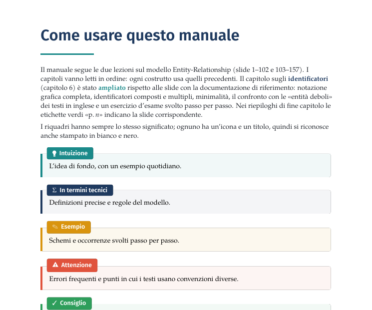
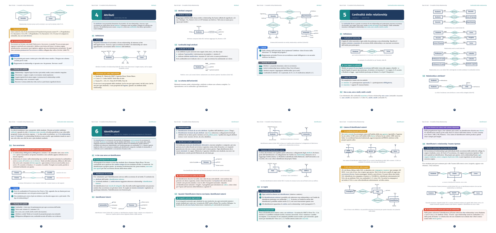
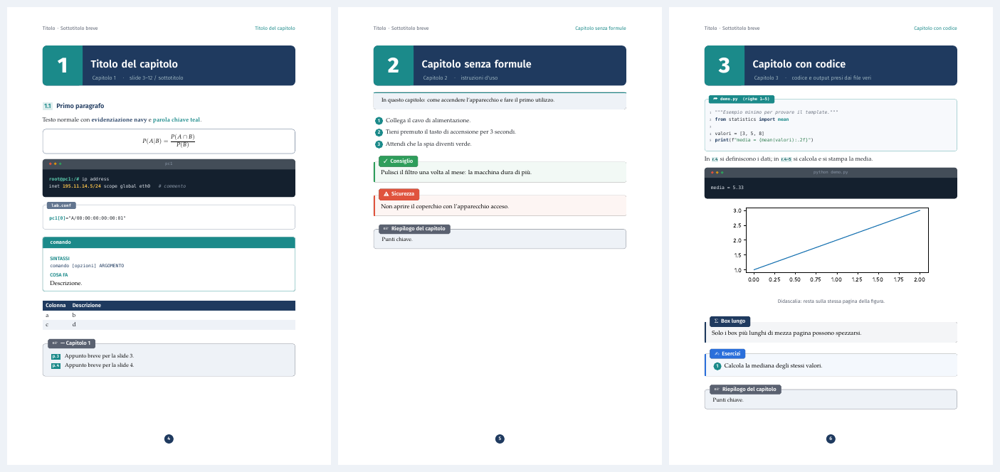

# design-manuale-pdf-skill

<a href="docs/img/hero-copertine.png"></a>

📘 **Una skill per Claude** che trasforma slide, appunti o un semplice argomento in un **manuale di studio in PDF**: impaginato in LaTeX, con contenuti verificati su fonti ufficiali e controllato automaticamente prima della consegna.<br>
📄 [I PDF di esempio](pdf/)<br>
🧩 [La skill (SKILL.md)](skill/design-manuale-pdf-skill/SKILL.md)<br>
📦 [Skill pronta da installare (ZIP)](dist/design-manuale-pdf-skill.zip)<br>
🛠️ [Strumenti di controllo](strumenti/)

---

## Indice

- [Che cosa fa](#che-cosa-fa)
- [Esempi](#esempi)
- [Come funziona](#come-funziona)
- [Gli strumenti](#gli-strumenti)
- [Installare la skill su Claude](#installare-la-skill-su-claude)
- [Compilare i manuali di questo repository](#compilare-i-manuali-di-questo-repository)
- [Struttura del repository](#struttura-del-repository)

---

## Che cosa fa

Chiedi a Claude un **manuale**, una **dispensa**, una **guida** o degli **appunti** in PDF. Puoi allegare del materiale (slide, PDF, testi) oppure indicare solo l'argomento. La skill fa lavorare Claude sempre allo stesso modo:

- **Contenuti affidabili.** Il tuo materiale è la base. Le fonti ufficiali e autorevoli (documentazione, libri di testo, standard) servono a verificarlo e completarlo. Se due fonti non sono d'accordo, il manuale lo dice in un box. Ciò che è stato ricostruito e non viene da nessuna fonte è dichiarato nel testo.
- **Uno schema fisso.** Ogni manuale ha:
  - copertina;
  - pagina «Come usare questo manuale»;
  - indice;
  - capitoli con riepilogo finale ed esercizi;
  - pagine finali: formulario o scheda riassuntiva, soluzioni, glossario e fonti.
- **Uno stile adattato al tema.** Font, box e struttura restano fissi; colori d'accento, motivo di copertina e figure si scelgono in base all'argomento.
- **Qualsiasi tipo di argomento.** Teoria con formule, software e comandi, codice Python, oppure l'uso di un oggetto senza formule né codice.
- **Rigore didattico.** Ogni concetto segue lo stesso percorso: prima l'idea semplice, poi la versione precisa, poi un esempio e infine come leggere il risultato. Gli esempi rispettano le regole che il manuale insegna, e ogni numero viene ricalcolato.
- **Un controllo qualità obbligatorio.** Due script controllano il codice e il PDF. Prima della consegna il manuale deve superare un «quality gate» di 9 punti.

<a href="docs/img/legenda-box.png"></a>

Ogni tipo di contenuto ha il suo riquadro, con icona e titolo, quindi si riconosce anche stampato in bianco e nero:

| Box | Uso |
|---|---|
| **Intuizione** (teal) | l'idea di fondo, con un'analogia |
| **Tecnica** (navy) | definizioni, formule, regole precise |
| **Esempio** (ambra) | casi svolti passo per passo, con numeri verificati |
| **Attenzione** (rosso) | errori frequenti, sicurezza, fonti in disaccordo |
| **Consiglio** (verde) | abitudini pratiche |
| **Approfondimento** (viola) | collegamenti e uso nel mondo reale |
| **Esercizi** (blu) | esercizi di fine capitolo, con soluzioni in appendice |
| **Riepilogo** (grigio) | i punti chiave del capitolo, con il numero della slide |

---

## Esempi

Quattro manuali reali generati con la skill. I PDF completi sono nella cartella [`pdf/`](pdf/).

### Classificatore di Bayes · teorico, con formule
Dalle slide di un corso di Machine Learning: probabilità, decisione ottima, stime parametriche, con grafici in matplotlib e un formulario finale.

<a href="docs/img/pagine-bayes.png"></a>

### Kathará, lab basic-ipv4 · tecnico, comandi e reti
Da un laboratorio di reti: ogni comando spiegato in una scheda, terminali con l'output reale, schemi della rete e diagrammi temporali disegnati in TikZ.

<a href="docs/img/pagine-kathara.png"></a>

### Random Forest · teoria e codice Python
Partendo solo dall'argomento: la matematica (Gini, bootstrap, varianza della media), quattro esempi eseguibili con scikit-learn commentati riga per riga e un'implementazione da zero in NumPy.

<a href="docs/img/pagine-rf.png"></a>

### Modello Entity-Relationship · schemi concettuali
Da due lezioni di Basi di dati, con la parte sugli identificatori ampliata usando il libro di testo e le dispense universitarie. Tutti gli schemi E-R sono ridisegnati in TikZ.

<a href="docs/img/pagine-er.png"></a>

---

## Come funziona

La skill guida Claude in nove passi:

1. **Fonti.** Legge tutto il materiale fornito, comprese le immagini delle pagine. Poi cerca fonti ufficiali per verificarlo e completarlo. Se c'è solo l'argomento, costruisce l'indice dalle fonti di riferimento.
2. **Tipo e stile.** Sceglie il tipo di manuale (teorico, tecnico, d'uso, procedurale) e decide palette, copertina e figure.
3. **Cartella di lavoro.** Prepara `preamble.tex` dal template, `main.tex` e un file per capitolo.
4. **Codice prima del testo.** Scrive gli script, li esegue con `controlla_codice.py` e genera le figure. Solo dopo scrive le spiegazioni, usando i numeri di riga e gli output reali.
5. **Scrittura dei capitoli.** Segue sempre il percorso idea → definizione precisa → esempio → come leggere il risultato.
6. **Compilazione.** Compila due volte con XeLaTeX e corregge finché non ci sono né errori né righe che escono dai margini.
7. **Controllo del PDF.** Esegue `controlla_pdf.py` e guarda tutti i fogli di anteprima. Le pagine delicate le controlla a risoluzione più alta.
8. **Quality gate.** Verifica 9 punti, tra cui: codice pulito e identico agli script consegnati, nessun blocco spezzato tra due pagine, nessun trattino doppio, fonti dichiarate.
9. **Consegna.** Invia il PDF con un riepilogo di struttura, fonti, limiti e parti ricostruite.

---

## Gli strumenti

### `strumenti/controlla_codice.py` · controllo degli script didattici

Si usa nei manuali che contengono codice Python, prima di includerlo nel PDF:

```bash
python3 strumenti/controlla_codice.py code/*.py
```

Per ogni script controlla che:
- nessuna riga superi i **78 caratteri**, così nel PDF il codice non va mai a capo da solo;
- tutti gli `import` siano **in testa** al file e che nessuno sia **inutilizzato**;
- lo script giri **senza errori né warning**.

Inoltre salva l'output reale in `output/<nome>.txt`, da includere nel PDF con `\outputfile`: testo e programma non possono divergere. Se trova problemi termina con codice di uscita 1.

<a href="docs/img/tool-controlla-codice.png"></a>

*Eseguito sugli script del manuale Random Forest, scritti prima di queste regole: trova righe troppo lunghe, un import inutilizzato e un import a metà file.*

### `strumenti/controlla_pdf.py` · controllo di qualità del PDF

Si esegue dopo la seconda compilazione:

```bash
python3 strumenti/controlla_pdf.py main.pdf
```

| Controllo | Tipo |
|---|---|
| `--` letterali (al posto di `–`), comandi LaTeX non interpretati, riferimenti `??`, delimitatori dei listing rimasti nel testo | ✗ errore: blocca la consegna |
| frammenti isolati in cima a una pagina (una parentesi `)` o la fine di una frase) | ⚠ avviso da verificare |
| pagine piene per meno del 40% | ⚠ avviso: va bene solo se un blocco intero è slittato |
| fogli di anteprima `qa/foglio-N.png`, 12 pagine ciascuno | da guardare tutti |

<a href="docs/img/tool-controlla-pdf.png"></a>

<a href="docs/img/tool-fogli-anteprima.png"></a>

*Un foglio di anteprima: 12 pagine in un'immagine, per vedere a colpo d'occhio blocchi spezzati, pagine vuote e figure fuori posto.*

### `template/` · il template di partenza

Un documento minimo che usa tutti gli elementi della skill. Serve a provare l'installazione di LaTeX e dei font e come punto di partenza per un nuovo manuale.

| File | A cosa serve |
|---|---|
| `preamble.tex` | tutto il sistema di design: font, colori, box, banner, listing, macro |
| `main.tex` | copertina, «Come usare», indice e tre capitoli: tecnico, senza formule, con codice. Poi l'appendice delle soluzioni |
| `code/demo.py` | script di esempio, incluso nel PDF con `\codicefile` |
| `figs/grafico.pdf` | figura di esempio, inclusa con `\figura` |

<a href="docs/img/template-anteprima.png"></a>

Le macro principali del template:

| Macro | Uso |
|---|---|
| `\sezione{n}{Titolo}{sottotitolo}` | banner di inizio capitolo |
| `\begin{tecnica}[Titolo][breakable]` | box; il secondo argomento facoltativo serve solo per i box più lunghi di mezza pagina |
| `\codicefile{file.py}{da}{a}` | righe reali di uno script, numerate come nel file |
| `\outputfile{output/file.txt}{titolo}` | output salvato dall'esecuzione |
| `\rr{36}[41]` | richiamo alle righe 36–41 nel testo |
| `\figura[larghezza]{file.pdf}{didascalia}` | figura e didascalia sempre sulla stessa pagina |
| `\begin{esercizi}` / `\soluzione{n.m}{…}` | esercizi e soluzioni in appendice |

### Gli script dei manuali

Ogni cartella in `manuali/` contiene gli script usati per quel manuale:

- `figs.py`: genera i grafici in PDF vettoriale con lo stile della skill (Bayes, Random Forest);
- `manuali/random-forest/code/es1…es5`: gli esempi didattici del manuale, eseguibili, con il loro output (`*.out`);
- `manuali/modello-er/er.tex`: la libreria TikZ per disegnare schemi E-R nella notazione di Atzeni et al. (entità, relationship, attributi, identificatori, generalizzazioni), riutilizzabile in altri documenti.

---

## Installare la skill su Claude

### Sull'app Claude (web, desktop)

1. Scarica [`dist/design-manuale-pdf-skill.zip`](dist/design-manuale-pdf-skill.zip). Lo ZIP contiene la cartella della skill al primo livello, come richiesto: **il nome della cartella deve coincidere con il campo `name` di `SKILL.md`**, e uno `SKILL.md` messo direttamente nella radice dello ZIP non viene riconosciuto come skill ([documentazione](https://claude.com/docs/skills/how-to)).
2. Sui piani **Free, Pro e Max**, vai in **Settings → Capabilities** e verifica che **Code execution and file creation** sia attivo. Nel nuovo layout delle impostazioni si chiama **Create and edit files**. Sui piani **Team ed Enterprise** le skill vanno abilitate dalle impostazioni dell'organizzazione ([guida](https://support.claude.com/en/articles/12512180)).
3. Vai in **Customize → Skills**, premi **«+»**, poi **«+ Create skill»** e **«Upload a skill»**, e carica lo ZIP ([guida](https://support.claude.com/en/articles/12512180-how-to-create-custom-skills)).
4. Attiva la skill nell'elenco. Da quel momento Claude la usa quando chiedi un manuale, una dispensa, una guida o degli appunti in PDF.

Le skill caricate sono **private** per il tuo account. Sui piani Team ed Enterprise si possono condividere con l'organizzazione se un amministratore lo consente.

### In Claude Code

**Opzione 1, skill personale** (disponibile in tutti i tuoi progetti):

```bash
mkdir -p ~/.claude/skills
cp -r skill/design-manuale-pdf-skill ~/.claude/skills/
```

**Opzione 2, skill di progetto.** Clonando questo repository la skill è già attiva: `.claude/skills/design-manuale-pdf-skill` è un collegamento alla cartella `skill/`.

Per avviarla basta chiedere un manuale, oppure richiamarla per nome con `/design-manuale-pdf-skill`.

Dettagli dalla [documentazione di Claude Code](https://code.claude.com/docs/en/skills):
- le skill personali stanno in `~/.claude/skills/<nome>/SKILL.md`, quelle di progetto in `.claude/skills/<nome>/SKILL.md`;
- aggiungere o modificare una skill in queste cartelle ha effetto nella sessione in corso, senza riavviare;
- le skill attivate nelle impostazioni dell'app Claude vengono caricate anche in Claude Code se accedi con lo stesso account.

### Requisiti per generare i PDF

La skill compila i PDF nell'ambiente in cui gira Claude, quindi lì devono esserci:
- **TeX Live con XeLaTeX** e i pacchetti `tcolorbox`, `tikz`, `listings`, `fontspec`, `needspace`, `titlesec`, `fancyhdr`, `tocloft`, `enumitem`, `pifont`;
- i font **TeX Gyre Pagella**, **Fira Sans** (Light, Regular, SemiBold, ExtraBold) e **DejaVu Sans Mono**;
- **Python 3** con `matplotlib` e `Pillow`, più `poppler-utils` (`pdftotext`, `pdftoppm`, `pdfinfo`) per gli strumenti di controllo.

Su Ubuntu/Debian:

```bash
sudo apt install texlive-xetex texlive-latex-extra texlive-pictures fonts-texgyre fonts-dejavu poppler-utils
pip install matplotlib pillow
```

Fira Sans si scarica da [Google Fonts](https://fonts.google.com/specimen/Fira+Sans) e si installa come font di sistema, per esempio in `~/.local/share/fonts/`, poi si esegue `fc-cache -f`. Per verificare che XeLaTeX la trovi: `fc-list | grep "Fira Sans"`.

Se manca un font, la skill usa il sostituto più simile e te lo segnala.

---

## Compilare i manuali di questo repository

```bash
cd manuali/modello-er
xelatex -interaction=nonstopmode main.tex
xelatex -interaction=nonstopmode main.tex      # seconda passata: copertina e indice
python3 ../../strumenti/controlla_pdf.py main.pdf
```

Per il Random Forest bisogna prima rigenerare output e figure:

```bash
cd manuali/random-forest/code
python3 es2_pipeline_tuning.py   # crea anche i CSV usati da figs.py
python3 figs.py
```

| Manuale | Tipo | Versione della skill |
|---|---|---|
| Classificatore di Bayes | teorico, con formule | v1 |
| Kathará, lab basic-ipv4 | tecnico, comandi e reti | v1 |
| Random Forest | teorico e codice Python | v1, da rigenerare con le regole v2 |
| Modello Entity-Relationship | teorico, schemi E-R in TikZ | v2 |

---

## Struttura del repository

```
manuali-pdf/
├── skill/design-manuale-pdf-skill/
│   ├── SKILL.md                 la skill: regole, template, strumenti
│   └── scripts/                 copia degli strumenti dentro la skill
├── .claude/skills/              collegamento alla skill: attiva in Claude Code
├── dist/design-manuale-pdf-skill.zip   pacchetto da caricare su Claude
├── strumenti/
│   ├── controlla_codice.py
│   └── controlla_pdf.py
├── template/                    template minimo da compilare
├── manuali/                     sorgenti LaTeX e script dei quattro manuali
├── pdf/                         i PDF compilati
└── docs/img/                    le immagini di questo README
```
