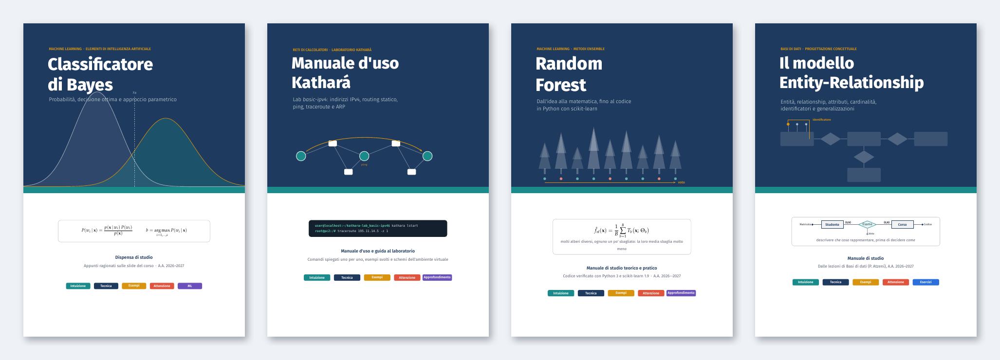
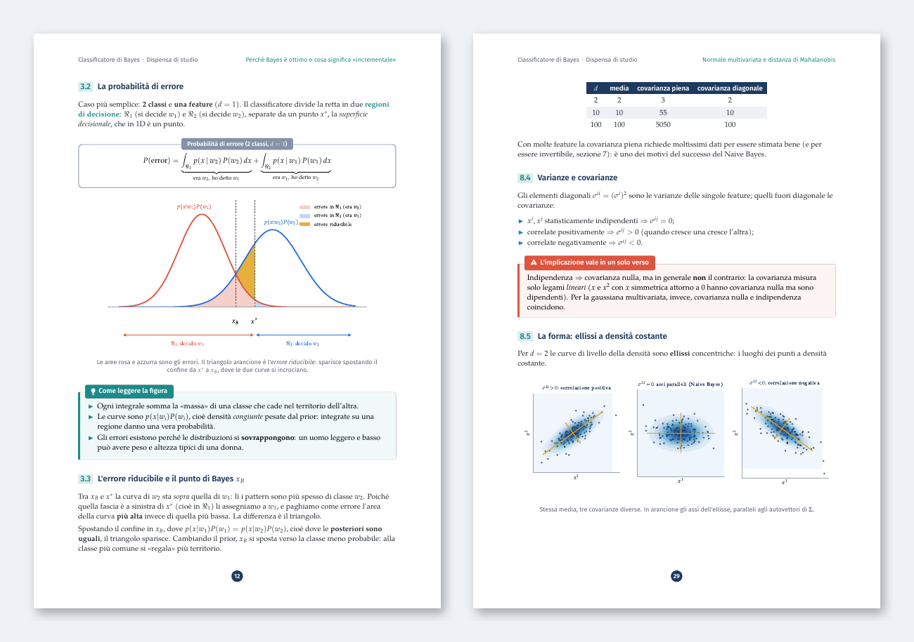
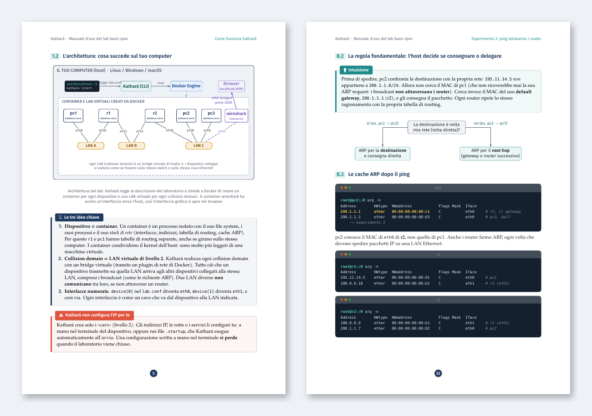
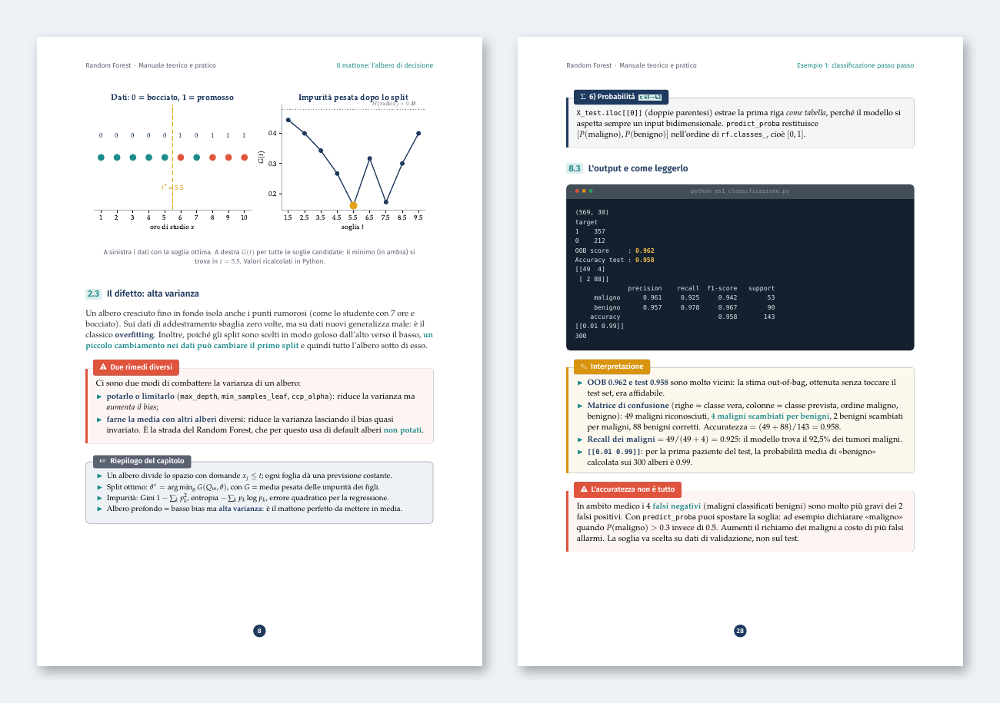
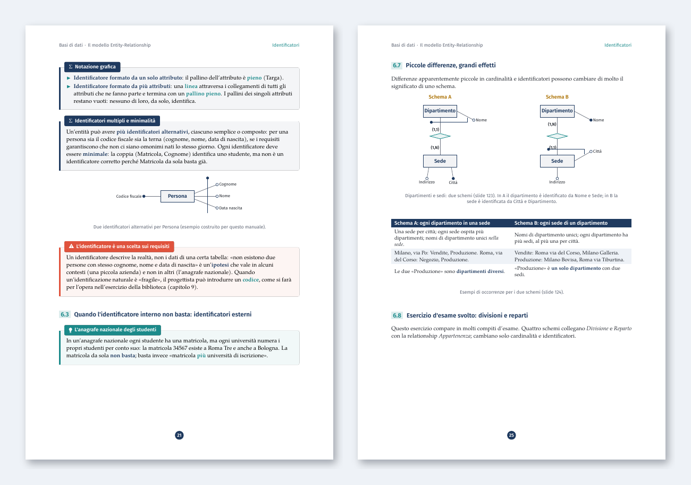
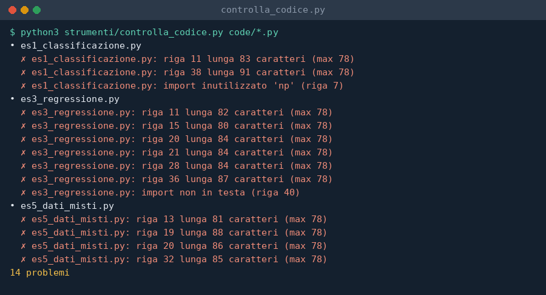
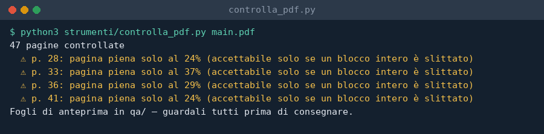

# Vivo_manual_skill

🇮🇹 [Versione italiana](README.it.md)

<a href="docs/img/hero-copertine.png"></a>

📘 **A skill for Claude** that turns slides, notes or just a topic into a **study manual in PDF**: typeset in LaTeX, with content checked against official sources and verified automatically before delivery.<br>
📄 [Sample PDFs](pdf/)<br>
🧩 [The skill (SKILL.md)](skill/design-manuale-pdf-skill/SKILL.md)<br>
📦 [Ready-to-install skill (ZIP)](dist/design-manuale-pdf-skill.zip)<br>
🛠️ [Quality-check tools](strumenti/)

> **Language note.** The skill's instructions and the sample manuals are written in **Italian**, the language they were built for. The skill can still produce manuals in other languages if you ask for it. The design and the workflow do not depend on the language.

---

## Contents

- [What it does](#what-it-does)
- [Examples](#examples)
- [How it works](#how-it-works)
- [The tools](#the-tools)
- [Installing the skill in Claude](#installing-the-skill-in-claude)
- [Building the manuals in this repository](#building-the-manuals-in-this-repository)
- [Repository layout](#repository-layout)

---

## What it does

Ask Claude for a **manual**, **handout**, **guide** or **study notes** as a PDF. You can attach material (slides, PDFs, text) or just name the topic. The skill makes Claude work the same way every time:

- **Reliable content.** Your material is the base. Official and authoritative sources (documentation, textbooks, standards) are used to check and complete it. When two sources disagree, the manual says so in a dedicated box. Anything reconstructed, rather than taken from a source, is flagged in the text.
- **A fixed structure.** Every manual has:
  - a cover page;
  - a «How to use this manual» page;
  - a table of contents;
  - chapters, each ending with a summary and exercises;
  - closing pages: formula sheet or quick reference, solutions, glossary and sources.
- **A style adapted to the topic.** Fonts, boxes and layout stay fixed. Accent colours, the cover motif and the figures are chosen to fit the subject.
- **Any kind of subject.** Theory with formulas, software and commands, Python code, or how to use a physical object, with no formulas or code at all.
- **Teaching rigour.** Every concept follows the same path: the simple idea first, then the precise version, then an example, and finally how to read the result. Examples follow the rules the manual teaches, and every number is recomputed.
- **Mandatory quality checks.** Two scripts check the code and the PDF. Before delivery the manual must pass a 9-point «quality gate».

<a href="docs/img/legenda-box.png"></a>

Each type of content has its own box, with an icon and a title, so it can be recognised even when printed in black and white:

| Box | Purpose |
|---|---|
| **Intuizione** (teal) · *Intuition* | the core idea, with an analogy |
| **Tecnica** (navy) · *Technical* | definitions, formulas, precise rules |
| **Esempio** (amber) · *Example* | step-by-step worked cases with verified numbers |
| **Attenzione** (red) · *Warning* | common mistakes, safety, conflicting sources |
| **Consiglio** (green) · *Tip* | practical habits |
| **Approfondimento** (violet) · *Going further* | connections and real-world use |
| **Esercizi** (blue) · *Exercises* | end-of-chapter exercises, with solutions in the appendix |
| **Riepilogo** (grey) · *Summary* | the chapter's key points, with slide numbers |

---

## Examples

Four real manuals generated with the skill. The full PDFs are in [`pdf/`](pdf/).

### Bayes classifier · theory with formulas
Built from the slides of a Machine Learning course: probability, optimal decisions and parametric estimation, with matplotlib charts and a final formula sheet.

<a href="docs/img/pagine-bayes.png"></a>

### Kathará, basic-ipv4 lab · technical, commands and networks
Built from a networking lab: every command explained on its own card, terminals showing real output, and network diagrams and timing diagrams drawn in TikZ.

<a href="docs/img/pagine-kathara.png"></a>

### Random Forest · theory and Python code
Built from the topic alone: the maths (Gini impurity, bootstrap, variance of an average), four runnable scikit-learn examples explained line by line, and an implementation from scratch in NumPy.

<a href="docs/img/pagine-rf.png"></a>

### Entity-Relationship model · conceptual schemas
Built from two Databases lectures, with the section on identifiers expanded using the course textbook and university lecture notes. Every E-R schema is redrawn in TikZ.

<a href="docs/img/pagine-er.png"></a>

---

## How it works

The skill guides Claude through nine steps:

1. **Sources.** Read all the material provided, including the page images. Then look up official sources to check and complete it. When only a topic is given, build the table of contents from reference sources.
2. **Type and style.** Choose the kind of manual (theory, technical, how-to, procedural) and decide the palette, cover and figures.
3. **Working folder.** Set up `preamble.tex` from the template, plus `main.tex` and one file per chapter.
4. **Code before text.** Write the scripts, run them through `controlla_codice.py` and generate the figures. Only then write the explanations, using the real line numbers and outputs.
5. **Write the chapters.** Always follow the path idea → precise definition → example → how to read the result.
6. **Compile.** Compile twice with XeLaTeX and fix things until there are no errors and no lines running past the margins.
7. **Check the PDF.** Run `controlla_pdf.py` and look at every preview sheet. Check the tricky pages at a higher resolution.
8. **Quality gate.** Verify 9 points, including: clean code identical to the delivered scripts, no block split across two pages, no stray double hyphens, sources declared.
9. **Delivery.** Send the PDF with a summary of the structure, sources, limits and reconstructed parts.

---

## The tools

### `strumenti/controlla_codice.py` · checks the teaching scripts

For manuals that contain Python code. Run it before including the code in the PDF:

```bash
python3 strumenti/controlla_codice.py code/*.py
```

For each script it checks that:
- no line is longer than **78 characters**, so code never wraps on its own in the PDF;
- all `import` statements are **at the top** of the file and none are **unused**;
- the script runs **with no errors and no warnings**.

It also saves the real output to `output/<name>.txt`, which goes into the PDF with `\outputfile`, so the text and the program can never diverge. It exits with code 1 if it finds problems.

<a href="docs/img/tool-controlla-codice.png"></a>

*Run on the scripts of the Random Forest manual, which were written before these rules: it finds lines that are too long, an unused import and an import in the middle of a file.*

### `strumenti/controlla_pdf.py` · checks the compiled PDF

Run it after the second compilation:

```bash
python3 strumenti/controlla_pdf.py main.pdf
```

| Check | Type |
|---|---|
| literal `--` (instead of `–`), uninterpreted LaTeX commands, `??` references, listing delimiters left in the text | ✗ error: blocks delivery |
| isolated fragments at the top of a page (a lone `)` or the end of a sentence) | ⚠ warning to review |
| pages less than 40% full | ⚠ warning: fine only if a whole block moved to the next page |
| preview sheets `qa/foglio-N.png`, 12 pages each | to be reviewed one by one |

<a href="docs/img/tool-controlla-pdf.png"></a>

<a href="docs/img/tool-fogli-anteprima.png"></a>

*A preview sheet: 12 pages in one image, to spot split blocks, empty pages and misplaced figures at a glance.*

### `template/` · the starting template

A minimal document that uses every element of the skill. Use it to test your LaTeX and font setup, or as the starting point for a new manual.

| File | Purpose |
|---|---|
| `preamble.tex` | the whole design system: fonts, colours, boxes, banners, listings, macros |
| `main.tex` | cover, «How to use», table of contents and three chapters: technical, formula-free and with code. Then the solutions appendix |
| `code/demo.py` | sample script, included in the PDF with `\codicefile` |
| `figs/grafico.pdf` | sample figure, included with `\figura` |

<a href="docs/img/template-anteprima.png"></a>

The main macros in the template:

| Macro | Purpose |
|---|---|
| `\sezione{n}{Title}{subtitle}` | chapter opening banner |
| `\begin{tecnica}[Title][breakable]` | box; the optional second argument is only for boxes longer than half a page |
| `\codicefile{file.py}{from}{to}` | real lines from a script, numbered as in the file |
| `\outputfile{output/file.txt}{title}` | output saved from the actual run |
| `\rr{36}[41]` | inline reference to lines 36–41 |
| `\figura[width]{file.pdf}{caption}` | figure and caption always kept on the same page |
| `\begin{esercizi}` / `\soluzione{n.m}{…}` | exercises, and their solutions in the appendix |

### Scripts used by the manuals

Each folder in `manuali/` contains the scripts used for that manual:

- `figs.py`: generates the charts as vector PDFs in the skill's style (Bayes, Random Forest);
- `manuali/random-forest/code/es1…es5`: the manual's runnable teaching examples, with their output (`*.out`);
- `manuali/modello-er/er.tex`: a TikZ library for drawing E-R schemas in the Atzeni et al. notation (entities, relationships, attributes, identifiers, generalisations), reusable in other documents.

---

## Installing the skill in Claude

### In the Claude app (web, desktop)

1. Download [`dist/design-manuale-pdf-skill.zip`](dist/design-manuale-pdf-skill.zip). The ZIP already has the skill folder at its top level, as required: **the folder name must match the `name` field in `SKILL.md`**, and a `SKILL.md` placed directly at the root of the ZIP is not recognised as a skill ([docs](https://claude.com/docs/skills/how-to)).
2. On **Free, Pro and Max** plans, go to **Settings → Capabilities** and make sure **Code execution and file creation** is on. In the updated settings layout it is called **Create and edit files**. On **Team and Enterprise** plans, skills are enabled in the organisation settings ([guide](https://support.claude.com/en/articles/12512180)).
3. Go to **Customize → Skills**, click **«+»**, then **«+ Create skill»** and **«Upload a skill»**, and upload the ZIP ([guide](https://support.claude.com/en/articles/12512180-how-to-create-custom-skills)).
4. Turn the skill on in the list. From then on Claude uses it whenever you ask for a manual, handout, guide or study notes in PDF.

Uploaded skills are **private** to your account. On Team and Enterprise plans they can be shared with the organisation if an admin allows it.

### In Claude Code

**Option 1, personal skill** (available in all your projects):

```bash
mkdir -p ~/.claude/skills
cp -r skill/design-manuale-pdf-skill ~/.claude/skills/
```

**Option 2, project skill.** If you clone this repository, the skill is already active: `.claude/skills/design-manuale-pdf-skill` is a link to the `skill/` folder. On Windows, git may turn the link into a plain file; in that case use option 1.

To use it, just ask for a manual, or invoke it by name with `/design-manuale-pdf-skill`.

From the [Claude Code documentation](https://code.claude.com/docs/en/skills):
- personal skills live in `~/.claude/skills/<name>/SKILL.md`, project skills in `.claude/skills/<name>/SKILL.md`;
- adding or editing a skill in these folders takes effect in the current session, with no restart needed;
- skills enabled in the Claude app settings are also loaded in Claude Code when you sign in with the same account.

### Requirements for generating PDFs

The skill compiles the PDFs in the environment where Claude runs, so that environment needs:
- **TeX Live with XeLaTeX** and the packages `tcolorbox`, `tikz`, `listings`, `fontspec`, `needspace`, `titlesec`, `fancyhdr`, `tocloft`, `enumitem`, `pifont`;
- the fonts **TeX Gyre Pagella**, **Fira Sans** (Light, Regular, SemiBold, ExtraBold) and **DejaVu Sans Mono**;
- **Python 3** with `matplotlib` and `Pillow`, plus `poppler-utils` (`pdftotext`, `pdftoppm`, `pdfinfo`) for the checking tools.

On Ubuntu/Debian:

```bash
sudo apt install texlive-xetex texlive-latex-extra texlive-pictures fonts-texgyre fonts-dejavu poppler-utils
pip install matplotlib pillow
```

Download Fira Sans from [Google Fonts](https://fonts.google.com/specimen/Fira+Sans) and install it as a system font, for example in `~/.local/share/fonts/`, then run `fc-cache -f`. To check that XeLaTeX can find it: `fc-list | grep "Fira Sans"`.

If a font is missing, the skill uses the closest substitute and tells you.

---

## Building the manuals in this repository

```bash
cd manuali/modello-er
xelatex -interaction=nonstopmode main.tex
xelatex -interaction=nonstopmode main.tex      # second pass: cover and table of contents
python3 ../../strumenti/controlla_pdf.py main.pdf
```

For the Random Forest manual, regenerate the outputs and figures first:

```bash
cd manuali/random-forest/code
python3 es2_pipeline_tuning.py   # also writes the CSV files used by figs.py
python3 figs.py
```

| Manual | Type | Skill version |
|---|---|---|
| Bayes classifier | theory, with formulas | v1 |
| Kathará, basic-ipv4 lab | technical, commands and networks | v1 |
| Random Forest | theory and Python code | v1, to be regenerated with the v2 rules |
| Entity-Relationship model | theory, E-R schemas in TikZ | v2 |

---

## Repository layout

```
manuali-pdf/
├── skill/design-manuale-pdf-skill/
│   ├── SKILL.md                 the skill: rules, template, tools
│   └── scripts/                 copy of the tools inside the skill
├── .claude/skills/              link to the skill: active in Claude Code
├── dist/design-manuale-pdf-skill.zip   package to upload to Claude
├── strumenti/                   quality-check tools
│   ├── controlla_codice.py      checks the teaching scripts
│   └── controlla_pdf.py         checks the compiled PDF
├── template/                    minimal template to compile
├── manuali/                     LaTeX sources and scripts of the four manuals
├── pdf/                         the compiled PDFs
└── docs/img/                    images used in this README
```
